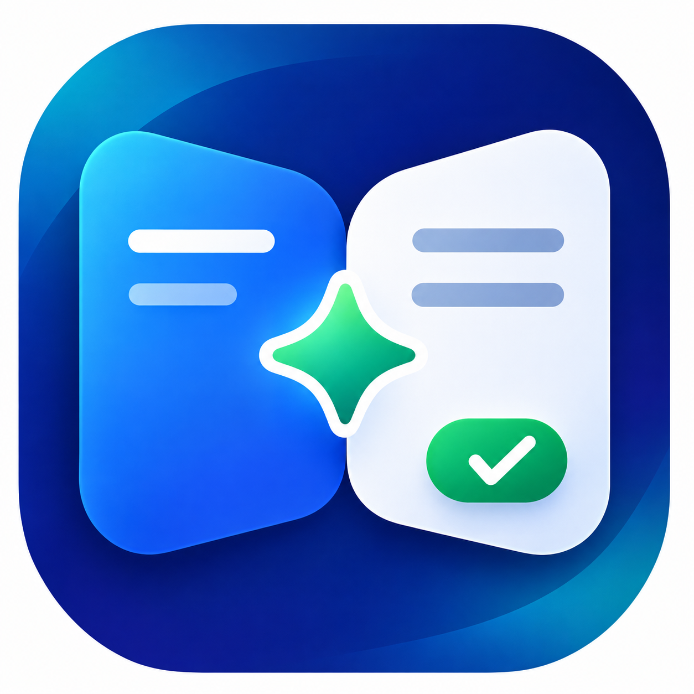

<p align="center">
  
</p>

# TutorAI

Un ambiente di studio per studenti universitari STEM: l'AI spiega, lo studente costruisce i propri appunti e il tutor aiuta a individuare le incomprensioni attraverso domande, correzioni verificabili e ripassi.

**Stato del progetto:** progettazione e mockup interattivo. L'interfaccia è esplorativa e non approvata integralmente. Importazione dei materiali, tutor, salvataggio e valutazioni sono simulati: il backend e l'integrazione AI devono ancora essere sviluppati.

## Come funziona l'idea

1. Si crea un corso e si aggiungono slide, appunti, programma ed esercizi disponibili.
2. Si sceglie tra **Lezione per lezione** e **Preparazione esame**.
3. A sinistra si legge una spiegazione collegata alle fonti; a destra si scrivono appunti con parole proprie.
4. Un passaggio poco chiaro può essere selezionato per chiedere spiegazioni nel suo contesto.
5. Al termine dell'unità il tutor propone domande sugli appunti e modifiche che lo studente può accettare, rifiutare o correggere.
6. Verifiche e ripassi registrano ciò che lo studente riesce a fare senza aiuti nell'app.

Gli appunti corretti e la conoscenza dimostrata restano due risultati distinti.

## Aprire il mockup

Clona o scarica il repository e apri [index.html](index.html) nel browser. Non servono chiavi API o installazioni di pacchetti. Font e KaTeX vengono caricati da CDN: occorre una connessione per quelle risorse.

La demo include Studio, Corso, Ripasso, selezioni contestuali, revisione e diff. Il pannello degli stati del prototipo permette di esplorare i casi dimostrativi. I dati visualizzati sono esempi, non corsi o risultati reali.

## Documentazione

Per iniziare, leggere **Specifica** e **Architettura**. Gli altri documenti approfondiscono interfaccia, implementazione e verifica.

| Documento | Contenuto |
| --- | --- |
| [Specifica di prodotto](docs/SPECIFICA.md) | Utenti, percorsi, requisiti F01–F17 e perimetro dell'MVP |
| [Architettura e harness](docs/ARCHITETTURA.md) | Quattro ambiti: tecnologie, dati, contesto/API, strumenti per ritagli e SVG |
| [Interfaccia](docs/INTERFACCIA.md) | Layout, interazioni, accessibilità e limiti del mockup |
| [Contratti e dati](docs/CONTRATTI_E_DATI.md) | Documento canonico, salvataggi, ancoraggi, patch, API ed evidenze |
| [Piano di sviluppo](docs/PIANO.md) | Fasi, prove tecniche e scenari AC01–AC18 |
| [Riferimenti](docs/RIFERIMENTI.md) | Presentazione, illustrazioni e origine delle scelte |

## Stack proposto

| Area | Base di lavoro |
| --- | --- |
| Interfaccia | React, TypeScript, Vite |
| Appunti | Tiptap/ProseMirror, documento JSON versionato, export Markdown |
| Backend | Fastify e worker Node |
| Dati e file | PostgreSQL, autenticazione e storage privato; Supabase come candidato gestito |
| Materiali e schemi | PDF.js, specifiche JSON controllate e Mermaid per gli SVG iniziali |
| Tutor | Provider API configurabile, contesto composto per attività e strumenti autorizzati |

Sono proposte da validare. Python/Docling, ricerca vettoriale e renderer personalizzati entrano quando le prove ne dimostrano l'utilità. L'architettura descrive anche le alternative per vincoli di offline o competenze diverse del team.

## Struttura del repository

```text
assets/logo.png          Logo condiviso
index.html               Mockup interattivo
docs/                    Specifiche e decisioni correnti
docs/riferimenti/        Presentazione e due illustrazioni del flusso
esempi/                  Dati e contratti illustrativi JSON
scripts/check_docs.py    Controllo di collegamenti, riferimenti e JSON
CONTRIBUTING.md          Guida alla collaborazione
```

## Lavorare insieme

Usare le [indicazioni per contribuire](CONTRIBUTING.md): attività piccole, branch dedicati e pull request con comportamento atteso e verifica. Prima dello sviluppo esteso vanno provati tre aspetti: estrazione dei materiali reali, integrità degli appunti durante revisione e conflitti, qualità/costo delle chiamate AI.

Per verificare i file del repository, con Python 3.10 o successivo:

```sh
python scripts/check_docs.py
```

Il comando controlla la documentazione e gli esempi; non testa un backend o una pipeline AI già implementati.
