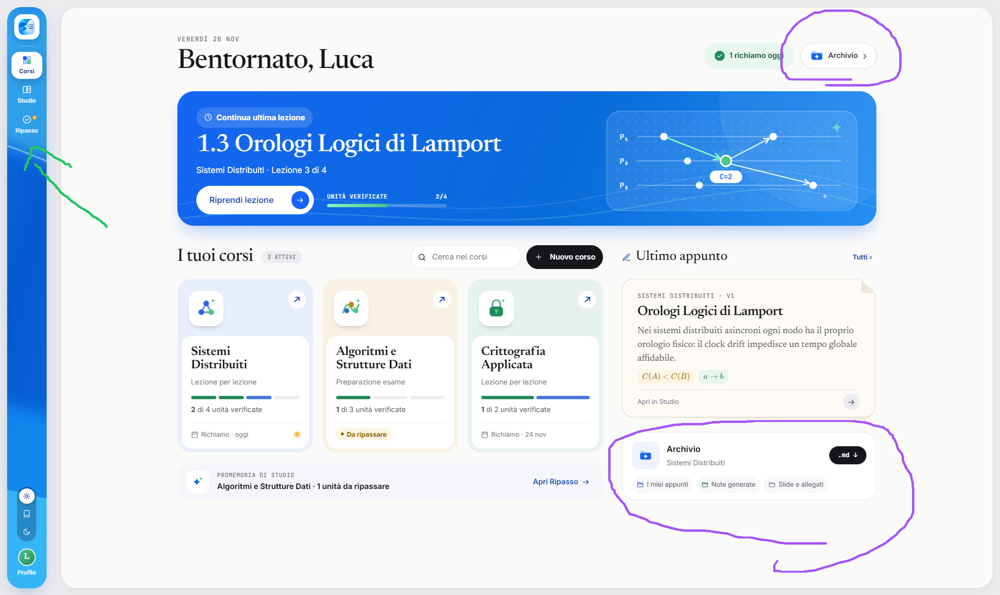
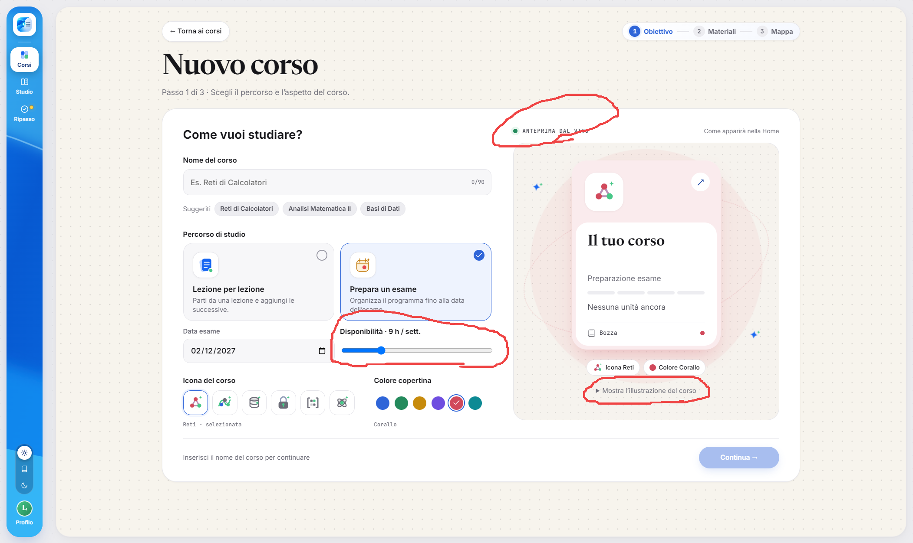
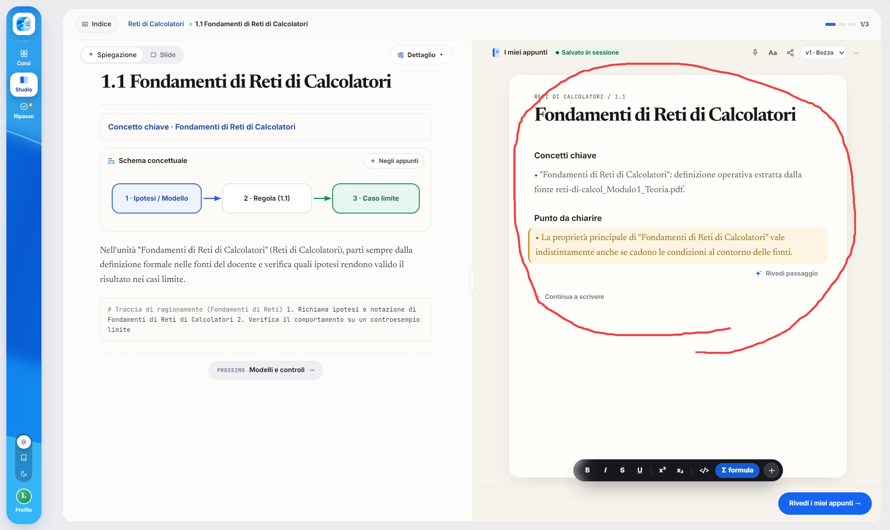
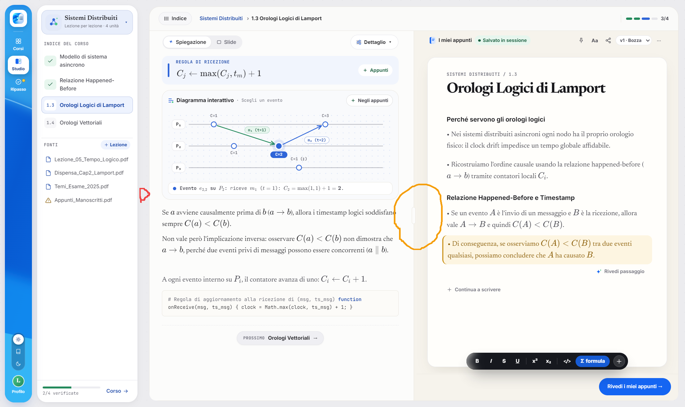
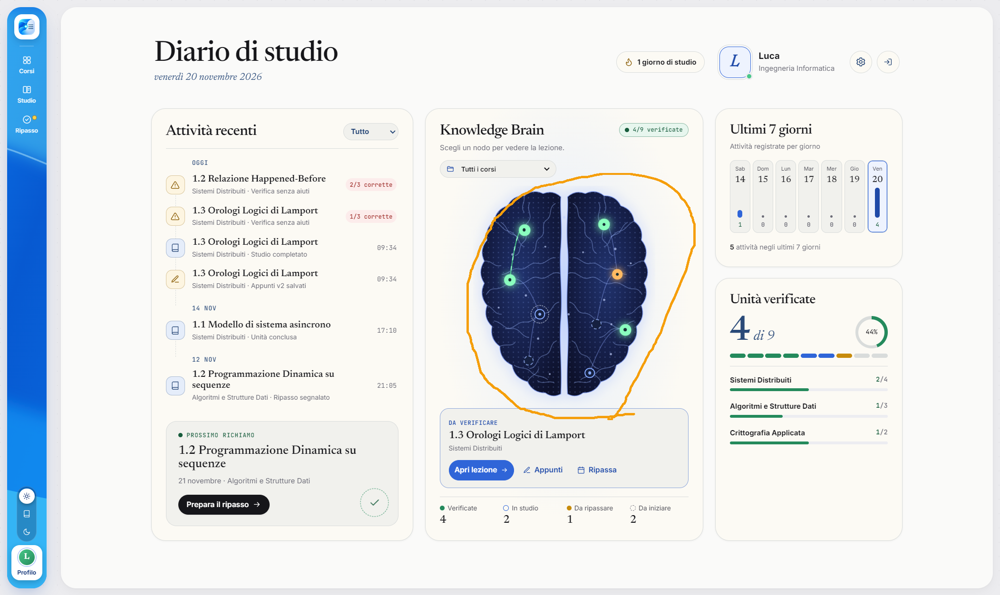
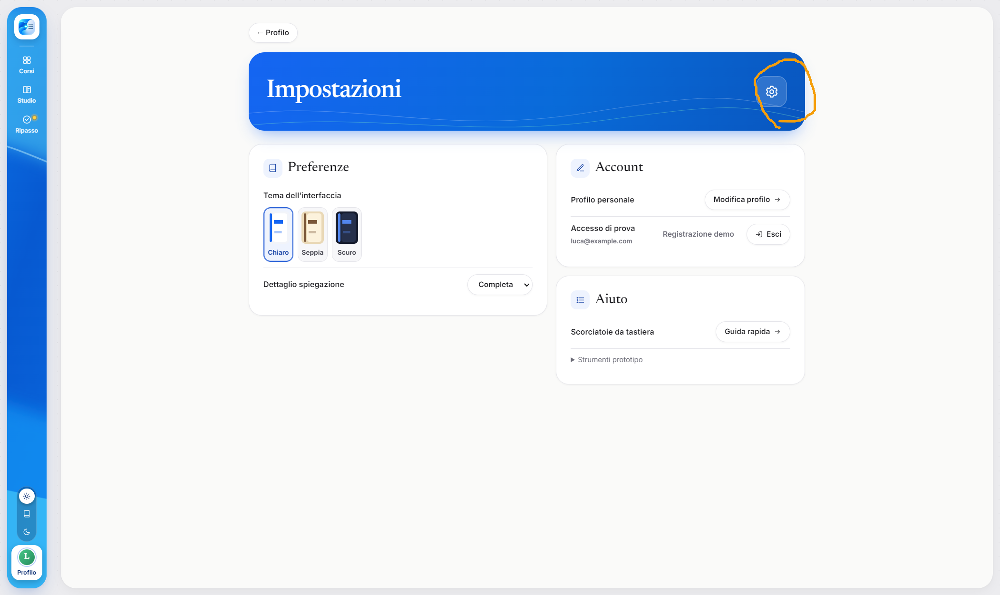
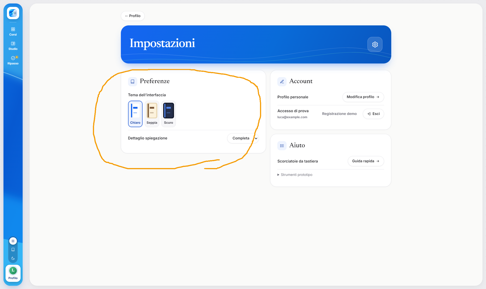

# Report Revisione UI (Visual AI Bug Tracker)

**Data Sessione:** 11/20/2026 - 9:40:29 AM  
**Totale Segnalazioni:** 9 (Critici: 1, Alti: 4, Medi: 4, Bassi: 0)

## Riepilogo Rapido

| # | Severità | Categoria | Viewport | Descrizione |
| :--- | :--- | :--- | :--- | :--- |
| #1 | ALTO | Layout | Desktop (Responsive 100%) | questo schema funziona solo quando viene suggerito orologi logici di lamport, ha senso ma  |
| #2 | ALTO | Layout | Desktop (Responsive 100%) | ci sono due archivi io ne lascerei uno forse li toglierei tutti e due e lo metterei a sini |
| #3 | ALTO | Layout | Desktop (Responsive 100%) | quando dico troppe cose ad esempio qui ci sta sia continua ultima lezione che riprendi lez |
| #4 | ALTO | Layout | Desktop (Responsive 100%) | abbellirei questo rendendolo più fluido e carino toglierei anteprima dal vivo le illustraz |
| #5 | MEDIO | Layout | Desktop (Responsive 100%) | la scrittura deve essere più nello stile obsidian, quindi con un flusso di scrittura conti |
| #6 | MEDIO | Layout | Desktop (Responsive 100%) | aggiungerei anche qui la cosa di poterlo ridimensionare come quello giallo che è perfetto |
| #7 | CRITICO | Layout | Desktop (Responsive 100%) | non è proprio bellissimo come cervello così, forse proverei uno stile meno realistico ma c |
| #8 | MEDIO | Layout | Desktop (Responsive 100%) | così sembra ci sia un altro bottone per le impostazioni da cliccare |
| #9 | MEDIO | Layout | Desktop (Responsive 100%) | aggiungerei altre preferenze |

---

## Bug #1 [ALTO · Layout]
* **Rotta / URL:** `file:///C:/Users/Luca/Desktop/TUTORAI/index.html`
* **Dispositivo / Viewport:** Desktop (Responsive 100%)
* **Ora scatto:** 9:28:38 AM

### Descrizione del Problema
> questo schema funziona solo quando viene suggerito orologi logici di lamport, ha senso ma forse deve solo far vedere qualcosa di più indicativo, o il primo svg visibile oppure niente e semplicemente espandere viola

### Riferimento Visivo Annotato


<details>
<summary>Frammento HTML / DOM</summary>

```html
<main class="main-wrap">

  <!-- =======================================================================
       VIEW 1: HOME LEARNING HUB + TRUE 3-STEP SEQUENTIAL WIZARD
       ======================================================================= -->
  <section class="view active" id="view-corso">
    <div class="page-scroll">
      <div class="home-container">

        <div id="homeHubContainer">
          <header class="welcome-bar">
            <div class="welcome-copy">
              <time class="welcome-eyebrow" id="welcomeDate" datetime="2026-11-20">venerdì 20 nov</time>
              <h1 id="welcomeTitle">Bentornato, Luca</h1>
            </div>
            <div class="welcome-actions">
              <button type="button" class="btn home-recall-pill" id="homeRecallsChip" onclick="openRipassoLobby(); selectRipassoDay(recallDateKey(new Date()))"><span class="home-recall-check"><svg class="ic " aria-hidden="true"><use href="#i-check"></use></svg></span> 1 richiamo oggi</button>
              <button type="button" class="btn home-vault-shortcut" onclick="openFileFinder()">
                <svg class="ic" aria-hidden="true"><use href="#i-study-folder"></use></svg> Archivio <span class="home-shortcut-chevron" aria-hidden="true">›</span>
              </button>
            </div>
          </header>

          <section class="resume-hero" id="homeHeroCard" aria-labelledby="resumeUnitTitle">
            <svg class="resume-hero-waves" viewBox="0 0 1180 220" preserveAspectRati
```
</details>

<details>
<summary>Log Errori Console (3)</summary>

```json
[
  {
    "level": "warn",
    "message": "%cElectron Security Warning (Insecure Content-Security-Policy) font-weight: bold; This renderer process has either no Content Security\n  Policy set or a policy with \"unsafe-eval\" enabled. This exposes users of\n  this app to unnecessary security risks.\n\nFor more information and help, consult\nhttps://electronjs.org/docs/tutorial/security.\nThis warning will not show up\nonce the app is packaged.",
    "source": "node:electron/js2c/sandbox_bundle",
    "line": 2,
    "timestamp": "9:26:43 AM"
  },
  {
    "level": "error",
    "message": "Uncaught TypeError: Cannot read properties of undefined (reading 'accent')",
    "source": "file:///C:/Users/Luca/Desktop/TUTORAI/index.html",
    "line": 5633,
    "timestamp": "9:26:58 AM"
  },
  {
    "level": "warn",
    "message": "%cElectron Security Warning (Insecure Content-Security-Policy) font-weight: bold; This renderer process has either no Content Security\n  Policy set or a policy with \"unsafe-eval\" enabled. This exposes users of\n  this app to unnecessary security risks.\n\nFor more information and help, consult\nhttps://electronjs.org/docs/tutorial/security.\nThis warning will not show up\nonce the app is packaged.",
    "source": "node:electron/js2c/sandbox_bundle",
    "line": 2,
    "timestamp": "9:26:59 AM"
  }
]
```
</details>

---

## Bug #2 [ALTO · Layout]
* **Rotta / URL:** `file:///C:/Users/Luca/Desktop/TUTORAI/index.html`
* **Dispositivo / Viewport:** Desktop (Responsive 100%)
* **Ora scatto:** 9:30:36 AM

### Descrizione del Problema
> ci sono due archivi io ne lascerei uno forse li toglierei tutti e due e lo metterei a sinistra (verde)
> al viola quello sotto metterei magari altro, oppure allungherei l'ultimo appunto e basta
> 
> forse per l'archivio quello in basso semplicemente metterei quel promemoria per lo studio e ripasso più in grande
> sia chiaro l'icona e l'archivio mi piace molto va solo messo secondo me a sinistra, oppure se hai altre proposte mentre leggi questo report fermami

### Riferimento Visivo Annotato


<details>
<summary>Frammento HTML / DOM</summary>

```html
<main class="main-wrap">

  <!-- =======================================================================
       VIEW 1: HOME LEARNING HUB + TRUE 3-STEP SEQUENTIAL WIZARD
       ======================================================================= -->
  <section class="view active" id="view-corso">
    <div class="page-scroll">
      <div class="home-container">

        <div id="homeHubContainer">
          <header class="welcome-bar">
            <div class="welcome-copy">
              <time class="welcome-eyebrow" id="welcomeDate" datetime="2026-11-20">venerdì 20 nov</time>
              <h1 id="welcomeTitle">Bentornato, Luca</h1>
            </div>
            <div class="welcome-actions">
              <button type="button" class="btn home-recall-pill" id="homeRecallsChip" onclick="openRipassoLobby(); selectRipassoDay(recallDateKey(new Date()))"><span class="home-recall-check"><svg class="ic " aria-hidden="true"><use href="#i-check"></use></svg></span> 1 richiamo oggi</button>
              <button type="button" class="btn home-vault-shortcut" onclick="openFileFinder()">
                <svg class="ic" aria-hidden="true"><use href="#i-study-folder"></use></svg> Archivio <span class="home-shortcut-chevron" aria-hidden="true">›</span>
              </button>
            </div>
          </header>

          <section class="resume-hero" id="homeHeroCard" aria-labelledby="resumeUnitTitle">
            <svg class="resume-hero-waves" viewBox="0 0 1180 220" preserveAspectRati
```
</details>

<details>
<summary>Log Errori Console (1)</summary>

```json
[
  {
    "level": "warn",
    "message": "%cElectron Security Warning (Insecure Content-Security-Policy) font-weight: bold; This renderer process has either no Content Security\n  Policy set or a policy with \"unsafe-eval\" enabled. This exposes users of\n  this app to unnecessary security risks.\n\nFor more information and help, consult\nhttps://electronjs.org/docs/tutorial/security.\nThis warning will not show up\nonce the app is packaged.",
    "source": "node:electron/js2c/sandbox_bundle",
    "line": 2,
    "timestamp": "9:28:39 AM"
  }
]
```
</details>

---

## Bug #3 [ALTO · Layout]
* **Rotta / URL:** `file:///C:/Users/Luca/Desktop/TUTORAI/index.html`
* **Dispositivo / Viewport:** Desktop (Responsive 100%)
* **Ora scatto:** 9:31:28 AM

### Descrizione del Problema
> quando dico troppe cose ad esempio qui ci sta sia continua ultima lezione che riprendi lezione, io lascerei quello sopra e quello sotto semplicemente metterei solo il cerchio con la freccia magari sempre bello esteticamente

### Riferimento Visivo Annotato


<details>
<summary>Frammento HTML / DOM</summary>

```html
<main class="main-wrap">

  <!-- =======================================================================
       VIEW 1: HOME LEARNING HUB + TRUE 3-STEP SEQUENTIAL WIZARD
       ======================================================================= -->
  <section class="view active" id="view-corso">
    <div class="page-scroll">
      <div class="home-container">

        <div id="homeHubContainer">
          <header class="welcome-bar">
            <div class="welcome-copy">
              <time class="welcome-eyebrow" id="welcomeDate" datetime="2026-11-20">venerdì 20 nov</time>
              <h1 id="welcomeTitle">Bentornato, Luca</h1>
            </div>
            <div class="welcome-actions">
              <button type="button" class="btn home-recall-pill" id="homeRecallsChip" onclick="openRipassoLobby(); selectRipassoDay(recallDateKey(new Date()))"><span class="home-recall-check"><svg class="ic " aria-hidden="true"><use href="#i-check"></use></svg></span> 1 richiamo oggi</button>
              <button type="button" class="btn home-vault-shortcut" onclick="openFileFinder()">
                <svg class="ic" aria-hidden="true"><use href="#i-study-folder"></use></svg> Archivio <span class="home-shortcut-chevron" aria-hidden="true">›</span>
              </button>
            </div>
          </header>

          <section class="resume-hero" id="homeHeroCard" aria-labelledby="resumeUnitTitle">
            <svg class="resume-hero-waves" viewBox="0 0 1180 220" preserveAspectRati
```
</details>

<details>
<summary>Log Errori Console (2)</summary>

```json
[
  {
    "level": "error",
    "message": "Uncaught TypeError: Cannot read properties of undefined (reading 'accent')",
    "source": "file:///C:/Users/Luca/Desktop/TUTORAI/index.html",
    "line": 5633,
    "timestamp": "9:30:36 AM"
  },
  {
    "level": "warn",
    "message": "%cElectron Security Warning (Insecure Content-Security-Policy) font-weight: bold; This renderer process has either no Content Security\n  Policy set or a policy with \"unsafe-eval\" enabled. This exposes users of\n  this app to unnecessary security risks.\n\nFor more information and help, consult\nhttps://electronjs.org/docs/tutorial/security.\nThis warning will not show up\nonce the app is packaged.",
    "source": "node:electron/js2c/sandbox_bundle",
    "line": 2,
    "timestamp": "9:30:36 AM"
  }
]
```
</details>

---

## Bug #4 [ALTO · Layout]
* **Rotta / URL:** `file:///C:/Users/Luca/Desktop/TUTORAI/index.html`
* **Dispositivo / Viewport:** Desktop (Responsive 100%)
* **Ora scatto:** 9:32:30 AM

### Descrizione del Problema
> abbellirei questo rendendolo più fluido e carino
> 
> toglierei anteprima dal vivo
> 
> le illustrazioni del corso per ora le toglierei proprio

### Riferimento Visivo Annotato


<details>
<summary>Frammento HTML / DOM</summary>

```html
<main class="main-wrap">

  <!-- =======================================================================
       VIEW 1: HOME LEARNING HUB + TRUE 3-STEP SEQUENTIAL WIZARD
       ======================================================================= -->
  <section class="view active" id="view-corso">
    <div class="page-scroll">
      <div class="home-container">

        <div id="homeHubContainer" class="hidden">
          <header class="welcome-bar">
            <div class="welcome-copy">
              <time class="welcome-eyebrow" id="welcomeDate" datetime="2026-11-20">venerdì 20 nov</time>
              <h1 id="welcomeTitle">Bentornato, Luca</h1>
            </div>
            <div class="welcome-actions">
              <button type="button" class="btn home-recall-pill" id="homeRecallsChip" onclick="openRipassoLobby(); selectRipassoDay(recallDateKey(new Date()))"><span class="home-recall-check"><svg class="ic " aria-hidden="true"><use href="#i-check"></use></svg></span> 1 richiamo oggi</button>
              <button type="button" class="btn home-vault-shortcut" onclick="openFileFinder()">
                <svg class="ic" aria-hidden="true"><use href="#i-study-folder"></use></svg> Archivio <span class="home-shortcut-chevron" aria-hidden="true">›</span>
              </button>
            </div>
          </header>

          <section class="resume-hero" id="homeHeroCard" aria-labelledby="resumeUnitTitle">
            <svg class="resume-hero-waves" viewBox="0 0 1180 220" pre
```
</details>

<details>
<summary>Log Errori Console (2)</summary>

```json
[
  {
    "level": "error",
    "message": "Uncaught TypeError: Cannot read properties of undefined (reading 'accent')",
    "source": "file:///C:/Users/Luca/Desktop/TUTORAI/index.html",
    "line": 5633,
    "timestamp": "9:31:28 AM"
  },
  {
    "level": "warn",
    "message": "%cElectron Security Warning (Insecure Content-Security-Policy) font-weight: bold; This renderer process has either no Content Security\n  Policy set or a policy with \"unsafe-eval\" enabled. This exposes users of\n  this app to unnecessary security risks.\n\nFor more information and help, consult\nhttps://electronjs.org/docs/tutorial/security.\nThis warning will not show up\nonce the app is packaged.",
    "source": "node:electron/js2c/sandbox_bundle",
    "line": 2,
    "timestamp": "9:31:28 AM"
  }
]
```
</details>

---

## Bug #5 [MEDIO · Layout]
* **Rotta / URL:** `file:///C:/Users/Luca/Desktop/TUTORAI/index.html`
* **Dispositivo / Viewport:** Desktop (Responsive 100%)
* **Ora scatto:** 9:33:24 AM

### Descrizione del Problema
> la scrittura deve essere più nello stile obsidian, quindi con un flusso di scrittura continuo senza dover premere con + e avere blocchi singoli

### Riferimento Visivo Annotato


<details>
<summary>Frammento HTML / DOM</summary>

```html
<main class="main-wrap">

  <!-- =======================================================================
       VIEW 1: HOME LEARNING HUB + TRUE 3-STEP SEQUENTIAL WIZARD
       ======================================================================= -->
  <section class="view" id="view-corso">
    <div class="page-scroll">
      <div class="home-container">

        <div id="homeHubContainer" class="">
          <header class="welcome-bar">
            <div class="welcome-copy">
              <time class="welcome-eyebrow" id="welcomeDate" datetime="2026-11-20">venerdì 20 nov</time>
              <h1 id="welcomeTitle">Bentornato, Luca</h1>
            </div>
            <div class="welcome-actions">
              <button type="button" class="btn home-recall-pill" id="homeRecallsChip" onclick="openRipassoLobby(); selectRipassoDay(recallDateKey(new Date()))"><span class="home-recall-check"><svg class="ic " aria-hidden="true"><use href="#i-check"></use></svg></span> 1 richiamo oggi</button>
              <button type="button" class="btn home-vault-shortcut" onclick="openFileFinder()">
                <svg class="ic" aria-hidden="true"><use href="#i-study-folder"></use></svg> Archivio <span class="home-shortcut-chevron" aria-hidden="true">›</span>
              </button>
            </div>
          </header>

          <section class="resume-hero" id="homeHeroCard" aria-labelledby="resumeUnitTitle">
            <svg class="resume-hero-waves" viewBox="0 0 1180 220" preserveAspectRa
```
</details>

<details>
<summary>Log Errori Console (1)</summary>

```json
[
  {
    "level": "warn",
    "message": "%cElectron Security Warning (Insecure Content-Security-Policy) font-weight: bold; This renderer process has either no Content Security\n  Policy set or a policy with \"unsafe-eval\" enabled. This exposes users of\n  this app to unnecessary security risks.\n\nFor more information and help, consult\nhttps://electronjs.org/docs/tutorial/security.\nThis warning will not show up\nonce the app is packaged.",
    "source": "node:electron/js2c/sandbox_bundle",
    "line": 2,
    "timestamp": "9:32:30 AM"
  }
]
```
</details>

---

## Bug #6 [MEDIO · Layout]
* **Rotta / URL:** `file:///C:/Users/Luca/Desktop/TUTORAI/index.html`
* **Dispositivo / Viewport:** Desktop (Responsive 100%)
* **Ora scatto:** 9:34:13 AM

### Descrizione del Problema
> aggiungerei anche qui la cosa di poterlo ridimensionare come quello giallo che è perfetto

### Riferimento Visivo Annotato


<details>
<summary>Frammento HTML / DOM</summary>

```html
<main class="main-wrap">

  <!-- =======================================================================
       VIEW 1: HOME LEARNING HUB + TRUE 3-STEP SEQUENTIAL WIZARD
       ======================================================================= -->
  <section class="view" id="view-corso">
    <div class="page-scroll">
      <div class="home-container">

        <div id="homeHubContainer">
          <header class="welcome-bar">
            <div class="welcome-copy">
              <time class="welcome-eyebrow" id="welcomeDate" datetime="2026-11-20">venerdì 20 nov</time>
              <h1 id="welcomeTitle">Bentornato, Luca</h1>
            </div>
            <div class="welcome-actions">
              <button type="button" class="btn home-recall-pill" id="homeRecallsChip" onclick="openRipassoLobby(); selectRipassoDay(recallDateKey(new Date()))"><span class="home-recall-check"><svg class="ic " aria-hidden="true"><use href="#i-check"></use></svg></span> 1 richiamo oggi</button>
              <button type="button" class="btn home-vault-shortcut" onclick="openFileFinder()">
                <svg class="ic" aria-hidden="true"><use href="#i-study-folder"></use></svg> Archivio <span class="home-shortcut-chevron" aria-hidden="true">›</span>
              </button>
            </div>
          </header>

          <section class="resume-hero" id="homeHeroCard" aria-labelledby="resumeUnitTitle">
            <svg class="resume-hero-waves" viewBox="0 0 1180 220" preserveAspectRatio="none
```
</details>

<details>
<summary>Log Errori Console (2)</summary>

```json
[
  {
    "level": "error",
    "message": "Uncaught TypeError: Cannot read properties of undefined (reading 'accent')",
    "source": "file:///C:/Users/Luca/Desktop/TUTORAI/index.html",
    "line": 5633,
    "timestamp": "9:33:24 AM"
  },
  {
    "level": "warn",
    "message": "%cElectron Security Warning (Insecure Content-Security-Policy) font-weight: bold; This renderer process has either no Content Security\n  Policy set or a policy with \"unsafe-eval\" enabled. This exposes users of\n  this app to unnecessary security risks.\n\nFor more information and help, consult\nhttps://electronjs.org/docs/tutorial/security.\nThis warning will not show up\nonce the app is packaged.",
    "source": "node:electron/js2c/sandbox_bundle",
    "line": 2,
    "timestamp": "9:33:24 AM"
  }
]
```
</details>

---

## Bug #7 [CRITICO · Layout]
* **Rotta / URL:** `file:///C:/Users/Luca/Desktop/TUTORAI/index.html`
* **Dispositivo / Viewport:** Desktop (Responsive 100%)
* **Ora scatto:** 9:37:31 AM

### Descrizione del Problema
> non è proprio bellissimo come cervello così, forse proverei uno stile meno realistico ma come concetto ci sta

### Riferimento Visivo Annotato


<details>
<summary>Frammento HTML / DOM</summary>

```html
<main class="main-wrap">

  <!-- =======================================================================
       VIEW 1: HOME LEARNING HUB + TRUE 3-STEP SEQUENTIAL WIZARD
       ======================================================================= -->
  <section class="view" id="view-corso">
    <div class="page-scroll">
      <div class="home-container">

        <div id="homeHubContainer">
          <header class="welcome-bar">
            <div class="welcome-copy">
              <time class="welcome-eyebrow" id="welcomeDate" datetime="2026-11-20">venerdì 20 nov</time>
              <h1 id="welcomeTitle">Bentornato, Luca</h1>
            </div>
            <div class="welcome-actions">
              <button type="button" class="btn home-recall-pill hidden" id="homeRecallsChip" onclick="openRipassoLobby(); selectRipassoDay(recallDateKey(new Date()))"><span class="home-recall-check"><svg class="ic " aria-hidden="true"><use href="#i-check"></use></svg></span> 0 richiami oggi</button>
              <button type="button" class="btn home-vault-shortcut" onclick="openFileFinder()">
                <svg class="ic" aria-hidden="true"><use href="#i-study-folder"></use></svg> Archivio <span class="home-shortcut-chevron" aria-hidden="true">›</span>
              </button>
            </div>
          </header>

          <section class="resume-hero" id="homeHeroCard" aria-labelledby="resumeUnitTitle">
            <svg class="resume-hero-waves" viewBox="0 0 1180 220" preserveAspectRati
```
</details>

<details>
<summary>Log Errori Console (2)</summary>

```json
[
  {
    "level": "error",
    "message": "Uncaught TypeError: Cannot read properties of undefined (reading 'accent')",
    "source": "file:///C:/Users/Luca/Desktop/TUTORAI/index.html",
    "line": 5633,
    "timestamp": "9:34:13 AM"
  },
  {
    "level": "warn",
    "message": "%cElectron Security Warning (Insecure Content-Security-Policy) font-weight: bold; This renderer process has either no Content Security\n  Policy set or a policy with \"unsafe-eval\" enabled. This exposes users of\n  this app to unnecessary security risks.\n\nFor more information and help, consult\nhttps://electronjs.org/docs/tutorial/security.\nThis warning will not show up\nonce the app is packaged.",
    "source": "node:electron/js2c/sandbox_bundle",
    "line": 2,
    "timestamp": "9:34:13 AM"
  }
]
```
</details>

---

## Bug #8 [MEDIO · Layout]
* **Rotta / URL:** `file:///C:/Users/Luca/Desktop/TUTORAI/index.html`
* **Dispositivo / Viewport:** Desktop (Responsive 100%)
* **Ora scatto:** 9:37:52 AM

### Descrizione del Problema
> così sembra ci sia un altro bottone per le impostazioni da cliccare

### Riferimento Visivo Annotato


<details>
<summary>Frammento HTML / DOM</summary>

```html
<main class="main-wrap">

  <!-- =======================================================================
       VIEW 1: HOME LEARNING HUB + TRUE 3-STEP SEQUENTIAL WIZARD
       ======================================================================= -->
  <section class="view" id="view-corso">
    <div class="page-scroll">
      <div class="home-container">

        <div id="homeHubContainer">
          <header class="welcome-bar">
            <div class="welcome-copy">
              <time class="welcome-eyebrow" id="welcomeDate" datetime="2026-11-20">venerdì 20 nov</time>
              <h1 id="welcomeTitle">Bentornato, Luca</h1>
            </div>
            <div class="welcome-actions">
              <button type="button" class="btn home-recall-pill hidden" id="homeRecallsChip" onclick="openRipassoLobby(); selectRipassoDay(recallDateKey(new Date()))"><span class="home-recall-check"><svg class="ic " aria-hidden="true"><use href="#i-check"></use></svg></span> 0 richiami oggi</button>
              <button type="button" class="btn home-vault-shortcut" onclick="openFileFinder()">
                <svg class="ic" aria-hidden="true"><use href="#i-study-folder"></use></svg> Archivio <span class="home-shortcut-chevron" aria-hidden="true">›</span>
              </button>
            </div>
          </header>

          <section class="resume-hero" id="homeHeroCard" aria-labelledby="resumeUnitTitle">
            <svg class="resume-hero-waves" viewBox="0 0 1180 220" preserveAspectRati
```
</details>

<details>
<summary>Log Errori Console (2)</summary>

```json
[
  {
    "level": "error",
    "message": "Uncaught TypeError: Cannot read properties of undefined (reading 'accent')",
    "source": "file:///C:/Users/Luca/Desktop/TUTORAI/index.html",
    "line": 5633,
    "timestamp": "9:37:31 AM"
  },
  {
    "level": "warn",
    "message": "%cElectron Security Warning (Insecure Content-Security-Policy) font-weight: bold; This renderer process has either no Content Security\n  Policy set or a policy with \"unsafe-eval\" enabled. This exposes users of\n  this app to unnecessary security risks.\n\nFor more information and help, consult\nhttps://electronjs.org/docs/tutorial/security.\nThis warning will not show up\nonce the app is packaged.",
    "source": "node:electron/js2c/sandbox_bundle",
    "line": 2,
    "timestamp": "9:37:31 AM"
  }
]
```
</details>

---

## Bug #9 [MEDIO · Layout]
* **Rotta / URL:** `file:///C:/Users/Luca/Desktop/TUTORAI/index.html`
* **Dispositivo / Viewport:** Desktop (Responsive 100%)
* **Ora scatto:** 9:38:18 AM

### Descrizione del Problema
> aggiungerei altre preferenze

### Riferimento Visivo Annotato


<details>
<summary>Frammento HTML / DOM</summary>

```html
<main class="main-wrap">

  <!-- =======================================================================
       VIEW 1: HOME LEARNING HUB + TRUE 3-STEP SEQUENTIAL WIZARD
       ======================================================================= -->
  <section class="view" id="view-corso">
    <div class="page-scroll">
      <div class="home-container">

        <div id="homeHubContainer">
          <header class="welcome-bar">
            <div class="welcome-copy">
              <time class="welcome-eyebrow" id="welcomeDate" datetime="2026-11-20">venerdì 20 nov</time>
              <h1 id="welcomeTitle">Bentornato, Luca</h1>
            </div>
            <div class="welcome-actions">
              <button type="button" class="btn home-recall-pill hidden" id="homeRecallsChip" onclick="openRipassoLobby(); selectRipassoDay(recallDateKey(new Date()))"><span class="home-recall-check"><svg class="ic " aria-hidden="true"><use href="#i-check"></use></svg></span> 0 richiami oggi</button>
              <button type="button" class="btn home-vault-shortcut" onclick="openFileFinder()">
                <svg class="ic" aria-hidden="true"><use href="#i-study-folder"></use></svg> Archivio <span class="home-shortcut-chevron" aria-hidden="true">›</span>
              </button>
            </div>
          </header>

          <section class="resume-hero" id="homeHeroCard" aria-labelledby="resumeUnitTitle">
            <svg class="resume-hero-waves" viewBox="0 0 1180 220" preserveAspectRati
```
</details>

<details>
<summary>Log Errori Console (2)</summary>

```json
[
  {
    "level": "error",
    "message": "Uncaught TypeError: Cannot read properties of undefined (reading 'accent')",
    "source": "file:///C:/Users/Luca/Desktop/TUTORAI/index.html",
    "line": 5633,
    "timestamp": "9:37:53 AM"
  },
  {
    "level": "warn",
    "message": "%cElectron Security Warning (Insecure Content-Security-Policy) font-weight: bold; This renderer process has either no Content Security\n  Policy set or a policy with \"unsafe-eval\" enabled. This exposes users of\n  this app to unnecessary security risks.\n\nFor more information and help, consult\nhttps://electronjs.org/docs/tutorial/security.\nThis warning will not show up\nonce the app is packaged.",
    "source": "node:electron/js2c/sandbox_bundle",
    "line": 2,
    "timestamp": "9:37:53 AM"
  }
]
```
</details>

---

