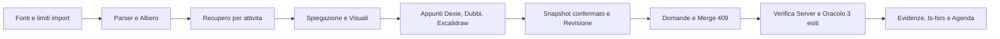

# TutorAI architettura e harness di studio

Stato: **versione finale consolidata (v3)** — allineata alla [Specifica di prodotto v3](SPECIFICA.md), ai [Contratti e dati](CONTRATTI_E_DATI.md) e al [Piano di sviluppo](PIANO.md) dopo revisione tecnica dual-model (Gemini 4 Neon + GPT 6.2 Astra).

| Ambito | Baseline consolidata (Fase 1 → Fase 2) | Cosa rinviare a Fasi 3–4 (solo su evidenza) |
| --- | --- | --- |
| 1 App, editor e sync | PWA autonoma React/TS/Vite, TanStack Query, Tiptap (MIT) + MathLive + Excalidraw editabile, **Dexie + protocollo ottimistico server**, Fastify/Hono + Zod + Drizzle, Better Auth (senza SSO) | Yjs/Hocuspocus (editing simultaneo), Capacitor (store), Tauri 2 (desktop offline), SSO IDEM SAML, plugin Obsidian separato |
| 2 Dati, storage e OCR | PostgreSQL (`FTS` + **indice simbolico** + `pg_trgm` + `pgvector`), `pg-boss`, Cloudflare R2 (o Supabase), `pypdfium2` + `DocumentParserProvider` (**1 percorso Managed** in Fase 1; BYOK/Locale in Fase 2) | Visual RAG cross-corso (`ColQwen2.5` + Qdrant), reranker obbligatorio (solo se giustificato dal benchmark), ParadeDB BM25 |
| 3 AI, oracolo STEM e budget | Vercel AI SDK (1 provider principale + escalation), recupero **per attività** + Prompt Caching, **verifica matematica autorevole server-side** (esito ternario, SymPy sandboxed), prenotazione atomica budget, Langfuse (metadati) | Routing multilivello automatico, Batch API (solo se conforme alla matrice ZDR/retention), Pyodide Web Worker (esercizi Python), PGlite SQL |
| 4 Harness, visuali ed export | Funzioni di dominio TS, ritagli WebP, Excalidraw (SVG deterministico in F1; variante AI su `sourceSceneHash` in F2), `ts-fsrs`, foto esercizi a 2 stadi (F2), Typst WASM + Anki (F2) | Audio lezioni (`WhisperX` / `Deepgram Nova-3`), simulatore orale real-time (`LiveKit Agents` / `Pipecat` + Silero VAD), cataloghi diagrammi estesi |

## 1 Tecnologie, sync sequenziale e accesso

### Stack applicativo unificato (TypeScript end-to-end)

La base è una **web app autonoma e installabile (PWA)** progettata per studio a due pannelli su desktop/tablet e consultazione/ripasso rapido su telefono in mobilità (es. in autobus prima di un esame).

* **Frontend:** React + TypeScript + Vite, **TanStack Query** (caching, retry, stato di rete), **cmdk** (Archivio `Ctrl+K` in Fase 2), **Motion** (micro-interazioni con `prefers-reduced-motion`).
* **Editor STEM:** **Tiptap / ProseMirror** con estensioni **MIT** (`UniqueID`, `Mathematics`, `Highlight` multicolore, `Dropcursor`, `BubbleMenu`), **KaTeX** per il rendering, **MathLive** per input visuale di formule su desktop/tablet (sorgente LaTeX canonica), **Excalidraw** (MIT) come blocco schizzo editabile e **Pragmatic Drag and Drop** (+ pulsante `+ Appunti` per touch/tastiera).
* **Backend e contratti:** **Fastify** (`fastify-type-provider-zod`) o **Hono** + **Zod** come singola fonte di verità condivisa fra database, API, structured outputs AI e client + **Drizzle ORM** (SQL esplicito, migrazioni trasparenti, zero vendor lock-in).
* **Worker e job:** worker Node + **`pg-boss`** su PostgreSQL per job persistenti, isolati e riprendibili senza Redis/Kafka in MVP.
* **Autenticazione (senza SSO Ateneo in MVP):** **Better Auth** integrato nel backend applicativo:
  * *Fase 1:* Email+Password + 1 provider OAuth per validare subito continuità e ripresa PC ↔ telefono;
  * *Fase 2:* **Passkey (WebAuthn)** per rientro rapido a 1 click su dispositivi personali e plugin **Anonymous** per la modalità *Ospite* blindata (corso dimostrativo già elaborato + budget rigido + migrazione del consumo all'account registrato).
  * *Fase 4 (istituzionale):* attivazione **SSO Ateneo (IDEM GARR / SAML 2.0)** via `@better-auth/sso` o broker Keycloak senza toccare il modello di dominio.

### Sync multi-dispositivo: perché Dexie + protocollo server in Fase 1–2

Il caso d'uso reale di uno studente singolo è il **passaggio sequenziale** tra dispositivi (PC → tablet → telefono). Un CRDT live (Yjs/Hocuspocus) introdurrebbe un secondo stato autorevole fuori dalla transazione PostgreSQL, rompendo l'atomicità promessa sul merge delle patch quando un dispositivo offline si riconnette dopo una patch accettata su un altro dispositivo.

* **Scelta consolidata Fase 1–2:** **Dexie (IndexedDB)** per bozza locale e coda mutazioni (`baseRevisionId`, `clientMutationId`, `clientSequence`). Il server aggiorna la testa della nota in transazione ACID **solo se `baseRevisionId` coincide**, gestisce retry duplicati in modo idempotente e su divergenza conserva entrambe le versioni aprendo un confronto esplicito.
* **Mobilità (autobus):** Service Worker PWA + cache locale per appunti, spiegazioni ed esercitazioni offline (distinte dalle verifiche certificate lato server; vedi [Contratti e dati](CONTRATTI_E_DATI.md)).
* **Condizione per riaprire Yjs (Fase 3–4):** solo se il pilota misura modifiche concorrenti frequenti su due dispositivi attivi contemporaneamente o se entra la collaborazione tra studenti, accompagnato da un protocollo formale di serializzazione dei merge.

### Pipeline documentale, sicurezza import e OCR

1. **Difesa in profondità sull'import (`ZIP` e `PDF`):** prima di qualunque coda AI, il worker applica limiti cumulativi durante decompressione e rendering: numero massimo di file, byte massimi espansi, controllo anti *Zip Slip* sui percorsi, limite pagine, limite megapixel raster e timeout CPU per singolo job. Un file anomalo fallisce in isolamento senza degradare altri corsi.
2. **Rendering server-side (`pypdfium2`) + viewer client (`PDF.js`):** **`pypdfium2`** (Apache 2.0/BSD) genera raster e ritagli WebP/PNG sul server in modo rapido e fedele anche su PDF Beamer/LaTeX (evitando fragilità di `node-canvas` e la licenza AGPL di PyMuPDF); **`PDF.js`** gestisce il viewer interattivo e l'overlay delle regioni nel browser.
3. **Contratto `DocumentParserProvider` (1 modalità in Fase 1, 3 in Fase 2):**
   * *Fase 1:* estrazione digitale nativa su testi/PDF puliti + **un solo percorso OCR gestito (Managed)** sulle pagine complesse/scansionate. L'output dichiara sempre se la posizione è `verified_region`, `text_ok_region_uncertain` (utilizzabile per la ricerca ma non per un ritaglio automatico affidabile) oppure `page_only` (mostra la pagina intera originale).
   * *Fase 2:* estensione dietro lo stesso contratto a **BYOK** (con cifratura envelope, revoca immediata, limiti spesa e chiarezza sulle condizioni dell'account esterno) e **Locale** (pairing autenticato worker↔account, versioning e validazione rigorosa dei manifest restituiti).
4. **Audit di licenza per singolo artefatto:** la scelta del motore Managed si chiude in Fase 0 su pagine STEM annotate a mano, verificando la licenza esatta di **codice, checkpoint e dipendenze distribuite** (tenendo conto che il catalogo modelli di Docling include pesi con licenze diverse da MIT, che MinerU prevede obbligo di attribuzione online e clausole commerciali distinte, e che checkpoint specifici come `allenai/olmOCR-2-7B-1025` dichiarano Apache-2.0).

## 2 Gestione dei dati, storage e recupero per attività

### Tre classi con responsabilità distinte

| Classe | Contenuti | Regola |
| --- | --- | --- |
| Originali e asset privati | PDF, file estratti, foto esercizi, asset binari Excalidraw | **Cloudflare R2** (egress zero, ideale per ritagli WebP e slide) o Storage privato Supabase; URL firmati brevi per utente/corso; nessuna condivisione cross-account delle slide |
| Stato e storia autorevoli | Utenti, corsi, albero fonti, revisioni JSON, `Dubbi`, patch, evidenze, trascrizioni foto, `ts-fsrs`, budget e `providerAttempts` | PostgreSQL con transazioni ACID; appunti ed evidenze sempre separati |
| Derivati ricostruibili | Indici testuali/simbolici/vettoriali, miniature, ritagli WebP, varianti SVG | Versionati per input + pipeline; purgati integralmente alla cancellazione del corso |

### Recupero governato dall'attività e ricerca simbolica

Anziché imporre una soglia fissa di token per decidere tra Prompt Caching e RAG, il recupero segue un ordine determinato dal compito (escludendo sempre soluzioni e aiuti proibiti nella fase corrente dal prefisso cachato):

1. **Riferimento diretto:** selezione o `regionId` noto → caricamento diretto con contesto locale minimo.
2. **Sezione completa con premesse:** navigazione dell'**albero strutturale** in PostgreSQL (ispirato a `PageIndex`) per preservare teoremi, ipotesi e dimostrazioni intere.
3. **Ricerca ibrida tra sezioni:**
   * **`FTS`** PostgreSQL per lessico e titoli;
   * **`pg_trgm`** *esclusivamente* per termini testuali, nomi di teoremi e identificatori alfanumerici (poiché `pg_trgm` ignora i caratteri non alfanumerici);
   * **campo simbolico normalizzato dedicato** che codifica esplicitamente operatori e relazioni (`<`, `>`, `<=`, `->`, `||`, pedici/struttura LaTeX/MathJSON) in token ricercabili, così `C(a) < C(b)` e `C(a) > C(b)` non collidono mai;
   * **`pgvector`** (HNSW) per parafrasi e registro orale/formale, da attivare dopo confronto sulla baseline testuale.
   * **Reranker:** escluso in Fase 1; introdotto solo se il benchmark dimostra che il passaggio corretto entra spesso nei top-20 candidati ma viene perso nella selezione finale.
4. **Lezione intera (con Prompt Caching):** impiegata quando serve copertura globale e supportata dal benchmark comparativo `8k / 20k / 40k` token a freddo e a caldo.

## 3 Layer AI, oracolo STEM, conformità ZDR e costi

### SDK agnostico, budget atomico e idempotenza dei tentativi

* **Vercel AI SDK** (Apache 2.0) con schemi **Zod** unificati: consente di cambiare provider senza riscrivere il dominio. In Fase 1 si usa **1 provider e 1 profilo principale** + eventuale escalation offline/mirata per il benchmark, rimandando routing automatico complesso a dopo le misure.
* **Prenotazione atomica del budget:** prima di accodare un job AI/OCR, il backend riserva atomicamente il costo massimo stimato verificando sia il **tetto per account** sia il **tetto globale giornaliero**, poi riconcilia sul consumo effettivo restituito dal provider.
* **Retry senza doppi effetti e senza costi ciechi:** ogni `operationId` traccia separatamente i singoli `providerAttempts`. Dopo un timeout di rete (esito sconosciuto, potenzialmente già fatturato dal provider) rispetto a un errore certo (`4xx`/`5xx`), il retry verifica la disponibilità di budget residuo prima di ripartire.

### Conformità dati: matrice obbligatoria prima dei calcoli economici

Residenza UE, esclusione dall'addestramento e **Zero Data Retention (ZDR)** sono proprietà indipendenti e variano per endpoint (es. gli endpoint `/v1/batches` di alcuni provider non supportano ZDR).
* Prima di fissare il budget del pilota si compila la **matrice `provider × endpoint × modello × regione × retention`**.
* L'uso di Batch API o Prompt Caching è ammesso **solo** sulle combinazioni conformi alla policy approvata; il modello economico (media e **p95**, separando **uso ordinario** e **settimana pre-esame**) viene calcolato esclusivamente su percorsi legali e conformi.

### Oracolo matematico autorevole (server) vs feedback UX (browser)

| Livello | Tecnologia | Ruolo e autorità |
| --- | --- | --- |
| **Client UX (non autorevole)** | `MathLive` + `CortexJS Compute Engine` | Validazione sintattica istantanea, anteprima espressioni e comodità input su tablet. **Mai** usato per promuovere concetti o aggiornare FSRS. |
| **Verifica autorevole (server)** | Micro-servizio **SymPy sandboxed** + regole su dominio esplicito | Esegue equivalenze simboliche e controlli di dominio (es. `x/x` vs `1` con `x ≠ 0`) su famiglie di esercizi dichiarate, accettando espressioni strutturate e operazioni in allowlist con limiti rigidi di CPU/RAM/timeout. Restituisce **3 esiti: `corretto`, `errato`, `indeterminato`**. |
| **Foto esercizi (Fase 2)** | VLM trascrizione → revisione utente → verifica server | Separa trascrizione (modificabile dallo studente) da valutazione; segni illeggibili danno `indeterminato`; ogni correzione ricalcola evidenza e FSRS. |
| **Codice Python (opzionale Fase 3+)** | `Pyodide` in **Web Worker isolato** | Sandbox opzionale client-side separata da credenziali/DOM principale con terminazione su timeout; non sostituisce la verifica server sulle prove certificate. |

### Osservabilità privacy-by-design (Langfuse)

* **Default di produzione (solo metadati):** ogni trace registra `operationId`, `providerAttemptId`, versioni prompt/schema/parser, token input/cache/output, latenza p50/p95, esito e costo — **senza** testo integrale di slide, risposte o foto dello studente.
* **Eval pedagogici offline:** suite dedicata su dataset autorizzati/anonimizzati per misurare *Grounded Citation Precision*, *No-Spoiling Rate*, *Socratic Precision* e resistenza a prompt injection.

## 4 Harness applicativo, schizzi Excalidraw ed export sicuro

| Operazione | Ingresso → Risultato | Controllo autorevole |
| --- | --- | --- |
| `retrieveContext` | Attività, selezione/query, fase → contesto e `regionId` | Server filtra tenant, versioni e blocca aiuti in verifica |
| `renderSourceRegion` | `regionId` verificato → URL firmato WebP (o pagina intera se incerto) | Worker `pypdfium2` su coordinate validate |
| `cleanSketchVariant` (F2) | Rappresentazione compatta scena + `sourceSceneHash` (+ raster se freehand) → variante riallineata/SVG | Legata all'hash iniziale; verifica semantica nodi/frecce/pedici |
| `reviewSnapshot` / `proposePatch` | Snapshot confermato + `Dubbi` → domande/patch con hash | Nessuna mutazione diretta; merge atomico in transazione Postgres |
| `verifyAttemptServer` | Risposta/foto (trascrizione confermata) + dominio + confidenza → esito ternario | Regole server + SymPy sandboxed + `ts-fsrs` |
| `exportOrShareNote` | Nota + modalità (`personal_export` vs `public_share`) → Markdown/Typst/Anki | Policy per asset: `public_share` rimuove/sostituisce asset del docente |

### Gestione degli schizzi Excalidraw

* **Fase 1:** blocco Excalidraw nativo sempre modificabile; salvataggio atomico della scena JSON + **tutti gli asset binari referenziati** + generazione deterministica dell'anteprima SVG.
* **Fase 2 (pulizia AI opzionale):** produce una **variante separata** agganciata a `sourceSceneHash`. Invece di inviare l'intero JSON grezzo (pesante su tratti a mano libera), invia una descrizione strutturata compatta di nodi, testi e collegamenti (più raster solo se necessario) facendo proporre **operazioni circoscritte di allineamento/etichettatura** rese poi dal renderer (o SVG pulito validato), così è verificabile che nodi, pedici e versi delle frecce non siano stati alterati.

## Prove di Fase 0 che chiudono i parametri tecnici

| Prova | Cosa confrontare su materiali reali annotati | Decisione chiusa |
| --- | --- | --- |
| 1. OCR STEM e licenze | Pagine con formule sottili, figure vettoriali, scansioni e rotazioni: errori matematici, accuratezza `regionId`, cold start, costo/50 pagine accettate (inclusi retry/avvio GPU) e audit licenze per `(codice, checkpoint, dipendenze)` | Scelta del singolo motore OCR Managed di Fase 1 |
| 2. Continuità Dexie e merge `409` | Scenario tablet offline + patch accettata su PC + riconnessione + interruzione server prima/dopo commit | Verifica zero perdita lavoro e tenuta ancoraggi `AC08/AC12` |
| 3. Recupero, cache e simboli | Confronto `8k / 20k / 40k` token a freddo/caldo per attività, verifica ricerca simbolica (`C(a)<C(b)` vs `C(a)>C(b)`) e test recall@20 per decidere il reranker | Politica di recupero, necessità reranker e budget reali |
| 4. Conformità, costi e SymPy | Compilazione matrice `provider×endpoint×regione×retention`, simulazione costi media/p95 (ordinario vs pre-esame) e test SymPy sandboxed (timeout, memoria, dominio `x/x` vs `1`) | Endpoint ammessi, sostenibilità economica e famiglie d'esercizio Fase 1 |
