# TutorAI architettura e harness di studio

Raccomandazione tecnica corrente. Lo stato è **P proposta**: team, budget, scala e necessità di offline restano da precisare. Il [mockup](../index.html) dà indicazioni di interazione e non è approvato integralmente.

Leggere [Specifica](SPECIFICA.md), [Contratti e dati](CONTRATTI_E_DATI.md) e [Piano di sviluppo](PIANO.md) per i requisiti e i criteri di verifica. Le fonti tecniche riportate sono state consultate durante la valutazione del 17 novembre 2026 e non sostituiscono prove d'integrazione.

| Ambito | Scelta iniziale | Cosa introdurre soltanto se serve |
| --- | --- | --- |
| 1 Applicazione e stack | Web per desktop, React/TypeScript, Tiptap, Fastify e worker Node | Desktop locale se offline è vincolante; Python se migliora davvero la pipeline documentale |
| 2 Dati | PostgreSQL e storage privato, revisioni e provenienza esplicite | Ricerca vettoriale dopo confronto con riferimenti diretti e ricerca testuale |
| 3 Contesto e API | Context composer per attività, budget, un provider e consumo osservabile | Più modelli, contesti più grandi o retrieval più complesso dopo misure |
| 4 Harness e visuali | Workflow applicativo, strumenti tipizzati, ritagli da PDF, JSON controllato → Mermaid → SVG | ELK e renderer proprio per limiti concreti di Mermaid; grammatiche scientifiche specializzate |

## 1 Tecnologie e distribuzione

### Distribuzione e struttura

La base raccomandata è una **web app**, utilizzabile senza installazione e pensata per leggere e scrivere affiancati. React con TypeScript e Vite compone l'interfaccia; Tiptap/ProseMirror gestisce il documento; Fastify espone comandi e letture; un worker Node svolge estrazione, rendering e chiamate lunghe. API e worker condividono dominio e contratti nello stesso repository. La versione del runtime va bloccata dopo la prova d'integrazione, partendo da Node 24 LTS come candidato da verificare nella combinazione scelta.

Gli appunti usano JSON strutturato canonico con ID dei blocchi, formule atomiche e revisioni. Markdown è un formato di scambio. L'editor rimane utilizzabile mentre l'AI lavora. Snapshot, sequenze di salvataggio e patch seguono il protocollo del documento Contratti e dati.

Supabase è il candidato operativo per PostgreSQL, autenticazione e file privati; non è il modello del dominio. Tenere query, migrazioni e riferimenti agli asset espliciti rende possibile cambiare hosting. Un worker con pg-boss è adatto quando i job devono sopravvivere a riavvii e ritentativi; non introdurre altre code o servizi distribuiti nella prima lezione integrata.

### Quando aggiungere Python

Non occorre Python soltanto per ottenere immagini dalle slide: Mozilla pubblica un esempio di rendering PDF → PNG in Node tramite PDF.js e la sua canvas factory. Bisogna provare anche font, CMap, WASM e dipendenze native nella build scelta. [Esempio ufficiale PDF.js per Node](https://github.com/mozilla/pdf.js/blob/master/examples/node/pdf2png/pdf2png.mjs).

Il confronto utile è fra **pipeline documentali complete**, non fra due librerie considerate equivalenti. PDF.js renderizza ed espone testo/geometria; la ricostruzione di lettura, figure e significato STEM richiede altro lavoro. Docling è un candidato per struttura e regioni, da provare anche sui PDF digitali complessi. La sua documentazione distingue estrazione di immagini native e ritagli del rendering. [Opzioni Docling](https://docling-project.github.io/docling/usage/advanced_options/).

Se Docling migliora il campione necessario al prodotto, aggiungere un worker Python documentale dietro un contratto: riceve versione della fonte e restituisce un manifest di pagine, passaggi, regioni e avvisi. Il backend rimane proprietario dello stato. Per rendering Python, pypdfium2 è una possibile alternativa; runtime, binari e relative licenze vanno verificati nella build. [API pypdfium2](https://pypdfium2.readthedocs.io/en/stable/python_api.html), [licenze del progetto](https://github.com/pypdfium2-team/pypdfium2#licensing).

Se il team è prevalentemente Python, FastAPI può sostituire Fastify; se materiali e AI devono restare offline, rivalutare Tauri/SQLite e modello locale. Queste sono varianti determinate dai vincoli, non componenti da mantenere tutte insieme.

## 2 Gestione dei dati

### Tre classi con responsabilità diverse

| Classe | Contenuti | Regola |
| --- | --- | --- |
| Originali e asset | PDF, testi importati, immagini, versioni dei file | Storage privato con hash e permessi; una fonte aggiornata crea una nuova versione |
| Stato e storia autorevoli | Corsi, unità, note, revisioni, spiegazioni, domande, risposte, evidenze, specifiche degli schemi | PostgreSQL con relazioni e transazioni; conservare esattamente ciò che lo studente ha visto e deciso |
| Derivati ricostruibili | Indici, embedding eventuali, miniature, ritagli e SVG renderizzati | Identificare input, versione della pipeline e parametri; ricostruire senza cambiare gli originali |

Una spiegazione o una specifica grafica prodotta dall'AI va conservata come versione: rigenerare con il modello non garantisce lo stesso risultato. È il rendering dello schema conservato a essere ricostruibile, non necessariamente la sua ideazione.

Le citazioni collegano corso, fonte, versione, pagina fisica/etichetta e passaggio o regione. Gli appunti corretti e la conoscenza dimostrata hanno tabelle e regole distinte. Il browser non può promuovere un concetto né applicare una patch attraverso un semplice flag.

### Ricerca e consistenza

Per la prima unità partire dai materiali già collegati alla lezione, da riferimenti espliciti e dalla ricerca testuale PostgreSQL. Confrontare questa baseline con una variante semantica; introdurre pgvector soltanto se migliora recupero e qualità su domande reali. Se adottato, ogni vettore porta modello, dimensione e versione dell'indice. Gli embedding restano quindi un'aggiunta da giustificare con il confronto sul corpus.

Salvataggi e decisioni passano dal server, con autorizzazione per utente/corso. Le revisioni sono immutabili; gli ACK identificano la precisa modifica salvata. Una patch controlla revisione, blocco e precondizioni e fallisce con un conflitto quando il bersaglio è cambiato. Una formula si modifica nella sua rappresentazione matematica canonica, non nel markup renderizzato. Copie locali di recupero, backup di database e backup dei file hanno scopi distinti.

## 3 Context window e chiamate API

### Un context composer per ciascuna attività

Il context composer è un modulo applicativo: legge dati autorizzati, seleziona evidenze, misura l'ingresso e prepara la richiesta. Il modello riceve soltanto gli strumenti pertinenti al compito.

| Parte del contesto | Contenuto |
| --- | --- |
| Policy stabile | Ruolo didattico, controllo dello studente, contratti di output e regole sulle fonti |
| Attività | Obiettivo dell'unità, percorso, fase corrente e modalità degli aiuti |
| Evidenze | Passaggi con ID e provenienza, parti pertinenti di bozza/risposta e precedenti esiti necessari |
| Visuali | Solo ritagli o pagine utili, con riferimenti agli asset e limiti espliciti |
| Compito preciso | Spiega, chiarisci, rivedi, proponi una correzione, valuta o pianifica |

La bozza analizzata deve essere una revisione identificata. I riepiloghi facilitano il recupero ma non sostituiscono fonti o evidenze. Se un dettaglio è decisivo, il sistema recupera il passaggio originale. I contenuti caricati restano dati, non istruzioni che possano cambiare permessi o workflow.

### Budget iniziali da provare

Proposta per il primo benchmark, **non soglie pedagogiche né dimensioni obbligatorie delle lezioni**:

| Attività | Tetto di ingresso indicativo | Riserva complessiva risposta e ragionamento | Immagini iniziali |
| --- | --- | --- | --- |
| Chiarimento su selezione | 4–6 mila token | 2–4 mila token | Nessuna, oppure una pertinente |
| Spiegazione di unità | 8–12 mila token | 4–8 mila token | Fino a due pertinenti |
| Revisione della bozza | 12–20 mila token | 4–8 mila token | Solo se necessarie al controllo |
| Valutazione di un tentativo | 6–10 mila token | 3–6 mila token | Materiale necessario al problema |

Il costo token delle immagini dipende da modello e rappresentazione: contare due immagini non ne misura il costo. La riserva deve includere il ragionamento quando previsto e può dover aumentare se il modello termina senza un output utile. La finestra massima è un limite; il budget operativo è una scelta da misurare. La documentazione OpenAI distingue ingresso, uscita e ragionamento nella finestra. [Gestione del contesto](https://developers.openai.com/api/docs/guides/conversation-state).

Prima dell'invio: misurare istruzioni, schemi, tool, testo e immagini; lasciare un margine rispetto al limite effettivo. Se il materiale supera il budget, restringere la revisione a una sezione esplicita o procedere per passaggi con risultati collegati. Non troncare silenziosamente una dimostrazione, omettere metà bozza dichiarandola interamente revisionata o inventare una risposta quando mancano fonti.

### Continuità cache e costo

Una microconversazione di chiarimento può aggiungere turni mantenendo il prefisso stabile. Al cambio di attività, oppure a un checkpoint di compattazione, comporre nuovamente il contesto dai dati persistiti. Non mantenere una conversazione illimitata come memoria dell'intero corso. Conservare i risultati utili, non richiedere o archiviare catene di ragionamento interne del modello. [Continuità del prefisso](https://developers.openai.com/api/docs/guides/preserved-reasoning).

La cache riusa prefissi compatibili; una sessione da sola non garantisce un hit. Stabilire breakpoint adatti al modello, evitando di scrivere in cache materiale che cambia continuamente. Misurare riuso e tariffazione; non allungare artificialmente i prompt per superare la soglia di cache. Input ordinario, letture di cache e scritture di cache sono categorie tariffarie distinte: la scrittura non è una maggiorazione da sommare una seconda volta all'input già conteggiato. [Prompt caching OpenAI](https://developers.openai.com/api/docs/guides/prompt-caching).

Anche `previous_response_id` non rende gratuita la storia precedente. Registrare per attività input ordinario, cache, output fatturato, ritentativi, immagini, strumenti, latenza e risultato. Imporre quote per operazione/sessione e permettere di continuare a scrivere quando la generazione non è disponibile. [Costo della storia nelle richieste concatenate](https://developers.openai.com/api/docs/guides/conversation-state).

Usare inizialmente un provider con un modello configurabile, senza instradamento automatico fra molti fornitori. Il confronto fra modelli usa gli stessi compiti e misura correttezza, fonti, falsi positivi, costo e attesa. Un modello più costoso è un'escalation deliberata per casi difficili, non un passaggio obbligatorio di ogni unità.

## 4 Costruzione dell harness e degli strumenti visuali

### Il workflow controlla il modello

Per harness si intende l'insieme di stato, contesto, strumenti, validatori e gestione degli errori che trasforma un modello in un tutor utilizzabile.

```mermaid
flowchart LR
    A[Materiali e corso] --> B[Contesto della unità]
    B --> C[Spiegazione e visuali]
    C --> D[Scrittura dello studente]
    D --> E[Revisione dello snapshot]
    E --> F[Domande e risposte]
    F --> G[Proposte di modifica]
    G --> H[Decisione dello studente]
    H --> I[Verifiche e ripasso]
```



Implementare le transizioni come funzioni di dominio TypeScript, con operazioni persistite e job riprendibili. Una libreria di macchine a stati è facoltativa; un framework agentico va introdotto solo per un bisogno concreto di workflow dinamico. Nessuno dei due sostituisce autorizzazioni, versioni e transazioni.

| Strumento o operazione | Cosa riceve e restituisce | Chi controlla |
| --- | --- | --- |
| `retrievePassages` | Query e unità → passaggi/regioni autorizzati con ID | Il server limita corso, versioni e quantità |
| `renderSourceRegion` | ID di una regione nota → asset e provenienza | Il renderer risolve coordinate già validate |
| `buildDiagram` | Specifica grafica limitata → risultato o errore | Validazione, compilatore e renderer |
| `explainUnit` / `clarifySelection` | Contesto e selezione versionata → spiegazione citata | Validatori delle citazioni e budget |
| `reviewSnapshot` / `proposePatch` | Bozza salvata e risposte → domande/proposte | Nessuna applicazione diretta del modello |
| `evaluateAttempt` / `suggestPlan` | Tentativo e condizioni → valutazione/piano proposto | Evidenze e regole applicative distinte dall'output AI |

Solo il comando dello studente può confermare il merge. Il risultato del modello è validato strutturalmente e nel dominio: JSON conforme non significa concetto corretto. Errori e timeout non producono patch o promozioni parziali; i ritentativi rispettano idempotenza e budget.

L'[esempio degli strumenti](../esempi/harness_visuale.json) mostra una regione risolta dal server, una chiamata con il solo `regionId`, uno schema e un piano di contesto. Dati e coordinate sono fittizi, collegati all'esempio di sessione; non descrivono operazioni già eseguite.

### Come ottenere automaticamente immagini dalle slide

Il processo usa il **file PDF**, senza fotografare lo schermo dell'utente:

1. Importare la fonte e conservarne versione e hash. Renderizzare una pagina alla risoluzione dichiarata con PDF.js nel worker Node.
2. Creare un catalogo di regioni da selezione dell'utente o pipeline di layout. Per le figure automatiche usare la pipeline che supera il campione di prova; Docling è il candidato se servono riconoscimento e struttura.
3. Assegnare `regionId`, pagina e rettangolo normalizzato rispetto alla **pagina visibile orientata**, con origine in alto a sinistra. Convertire esplicitamente eventuali coordinate PDF/Docling con cropbox, origine e rotazione. Il modello sceglie un ID esistente, non quattro numeri inventati.
4. Trasformare il rettangolo in pixel del raster effettivo, ritagliare includendo didascalie necessarie e salvare PNG o WebP con provenienza. Se la regione non è affidabile, usare la pagina intera o chiedere una selezione.
5. Memorizzare il derivato per hash della fonte, regione, parametri e versione del renderer, mantenendo controllo degli accessi. La citazione apre sempre anche la pagina originale.

Per il ritaglio basta una seconda canvas di dimensioni controllate e la copia del rettangolo dal raster; non richiede un'altra chiamata AI. Il rilevamento della figura, invece, richiede layout o una selezione e non deriva dal solo rendering. Docling documenta esportazione di pagine e figure, ma la qualità delle regioni rimane da misurare. [Esportazione delle figure](https://docling-project.github.io/docling/_generated/examples/export_figures/).

Distinguere l'immagine nativa incorporata nel PDF dal ritaglio di una regione composta: frecce vettoriali, etichette e formule possono essere oggetti separati. Usare il ritaglio del rendering quando serve preservare la composizione visibile.

### Come generare schemi SVG

Per il primo rilascio scegliere **un solo percorso**:

```text
Obiettivo e fonti → DiagramSpec JSON → validazione → compilatore Mermaid
                → rendering SVG → controllo finale → asset versionato
```

La specifica ammette inizialmente diagrammi di flusso e relazioni etichettate: tipo, nodi, archi, testi e riferimenti. Il compilatore assegna ID, escape dei testi e sintassi; il modello non fornisce codice Mermaid, direttive di configurazione, HTML o SVG liberi. Mermaid produce SVG dai suoi diagrammi; per asset salvati/esportati il worker può usare la CLI ufficiale, oltre all'anteprima nell'app. [Uso Mermaid](https://mermaid.js.org/config/usage), [Mermaid CLI](https://github.com/mermaid-js/mermaid-cli).

Il rendering CLI richiede il relativo ambiente browser/Puppeteer: va isolato e misurato nel job, con font e versioni fissati, timeout e rete disabilitata dopo il provisioning. La generazione non deve bloccare l'editor. Non si aggiunge un servizio AI di grafica: si renderizza una specifica già validata.

Per il sottoinsieme iniziale usare etichette testuali, `securityLevel: strict` e `htmlLabels: false`; configurazione fissata dall'applicazione, nessuna direttiva dai contenuti. Controllare l'SVG finale, escludendo script, handler e riferimenti esterni. Configurazione e sanitizzazione non provano correttezza scientifica. [Configurazione ufficiale Mermaid](https://mermaid.js.org/config/schema-docs/config.html).

Nel diagramma semplice si possono usare simboli e notazione testuale; le formule complesse restano accanto, renderizzate con KaTeX nell'ambiente di studio. Mermaid dispone anche di supporto matematico basato su KaTeX, ma non lo rendiamo un requisito dell'export SVG iniziale. [Matematica in Mermaid](https://mermaid.js.org/config/math.html).

**Quando passare a ELK e renderer proprio:** quando un requisito verificato richiede composizioni precise, port, interazioni stabili per elemento o formule vettoriali che il percorso iniziale non soddisfa. ELK calcola il layout e non disegna il diagramma; bisogna misurare le etichette e realizzare il renderer. La licenza del progetto è EPL 2.0, da includere nella valutazione delle dipendenze. [ELK.js](https://github.com/kieler/elkjs), [licenza](https://github.com/kieler/elkjs/blob/master/LICENSE.md).

Per formule vettoriali nel percorso avanzato MathJax offre conversione TeX → SVG anche in Node. Conservare sorgente e macro consentite, verificare il sottoinsieme comune con KaTeX e rendere visibili i casi non supportati. Non introdurre due renderer matematici senza questa prova. [MathJax in Node](https://docs.mathjax.org/en/latest/server/components.html), [SVG autonomi](https://docs.mathjax.org/en/latest/web/convert.html).

Per grafici numerici, circuiti o strutture chimiche servono grammatiche e strumenti specifici: un diagramma a nodi non li sostituisce. In ogni caso distinguere schema generato, dati del docente e ipotesi del tutor. Conservare specifica, fonti, versione del generatore e dell'asset; una figura bella non è una prova che la relazione rappresentata sia corretta.

## Prove che decidono le adozioni

| Prova | Cosa confrontare | Conseguenza |
| --- | --- | --- |
| Materiali e visuali | Stessi PDF STEM difficili: pipeline semplice e strutturata; regioni, formule, rotazioni, crop e diagrammi standard | Decide Docling/Python, perimetro dei formati e sufficienza di Mermaid |
| Integrità dello studio | Revisione mentre testo/formule cambiano, rete interrotta, riapertura e patch concorrenti | Nessuna modifica al punto sbagliato o perdita di testo salvato; chiarimenti su nodi atomici verificati |
| Costo e qualità didattica | Stessi compiti con riferimenti/FTS e variante semantica, diversi budget e modelli | Decide embedding, budget e modello; controllare errori e fonti, non soltanto il prezzo medio |

La prima dimostrazione comprende un PDF reale, un ritaglio citabile, uno schema semplice, scrittura persistente, domanda sulla bozza, diff approvato e verifica separata. PPTX nativo, scansioni estese e diagrammi specialistici entrano quando il campione ne giustifica il costo. Le capacità descritte sono da implementare e provare; non sono test già superati dal mockup.
